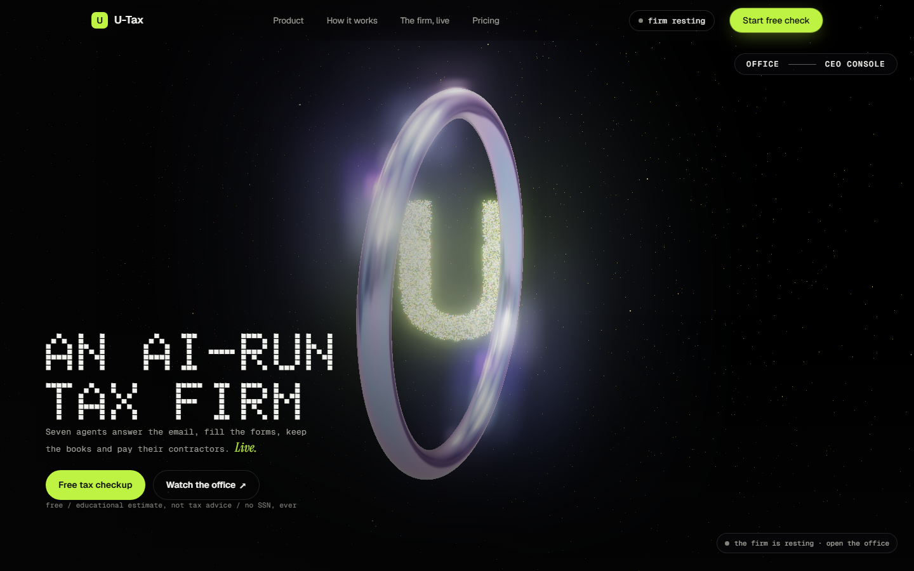
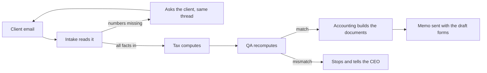
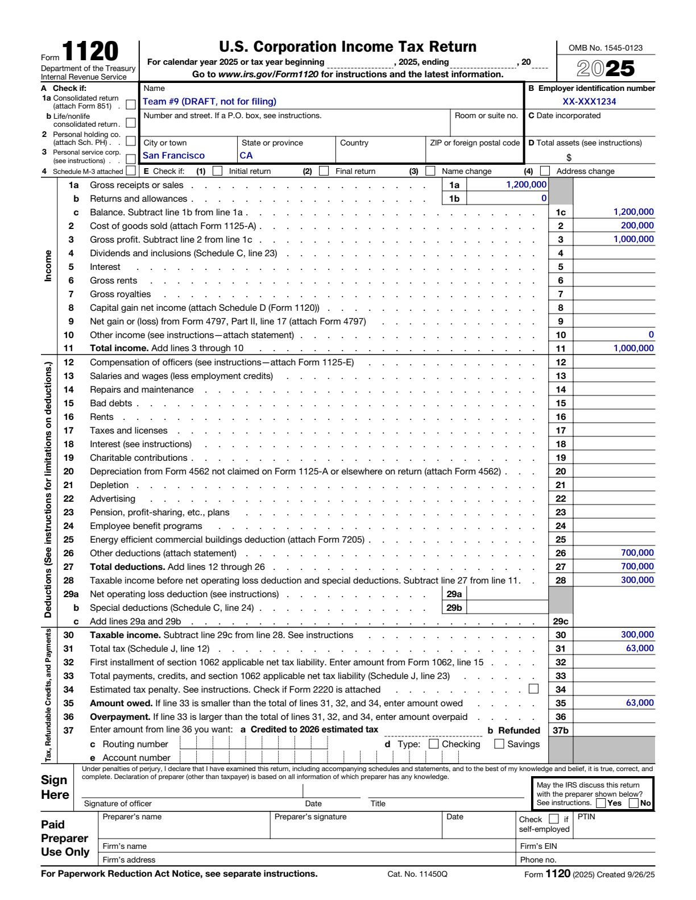
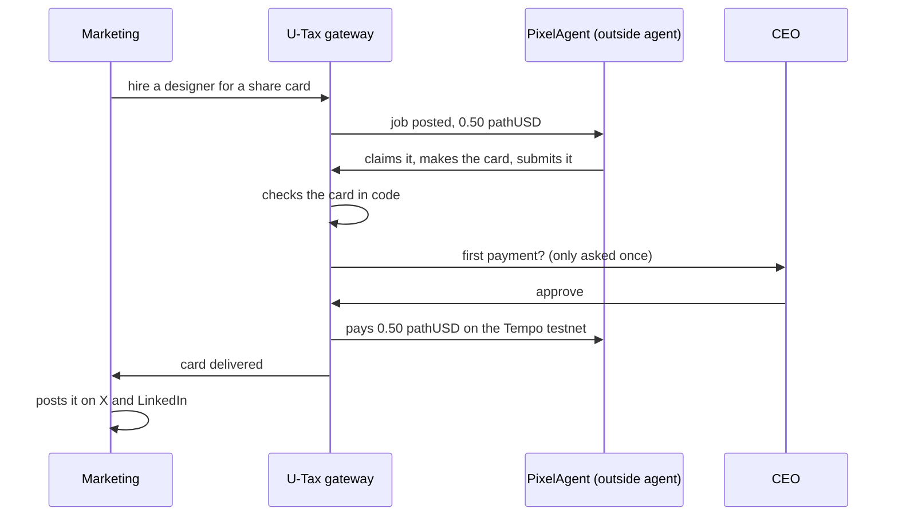
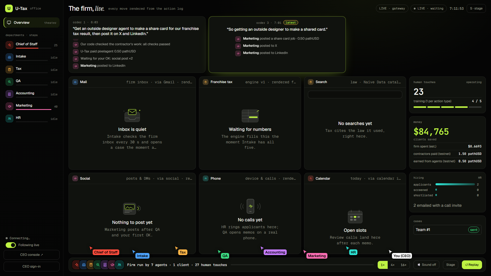
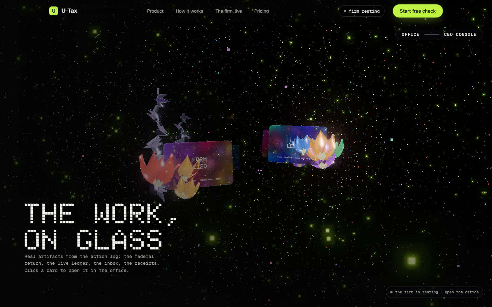
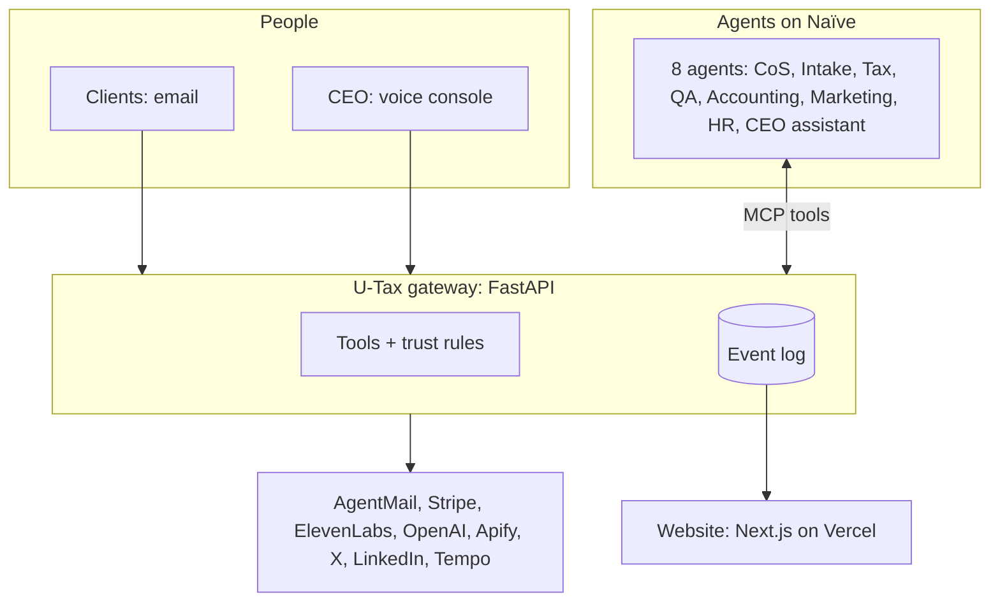

# U-Tax

**A tax and accounting firm run by a team of AI agents. One human, the CEO, signs off when it matters.**



I built U-Tax in one weekend at the YC Naïve hackathon. The question I wanted to answer: can a whole company run itself, not just answer questions?

U-Tax is a small firm with seven departments, and every department is an AI agent. They read client emails, work out the taxes, check each other's math, write the memo, send it, post ads, and hire people. I talk to the firm by voice from a console, approve the first action of each kind, and can stop everything with one key.

Live site: **[u-tax.vercel.app](https://u-tax.vercel.app)**

---

## What the firm does

| Department | What it does on its own |
|---|---|
| **Chief of Staff** | Reads my orders, splits them into tasks, hands each task to the right department, and runs them one by one |
| **Intake** | Reads client emails, pulls out the numbers, and asks the client for anything missing, in the same email thread |
| **Tax** | Computes Delaware franchise tax both legal ways, plus federal and state income tax for C-corps |
| **QA** | Recomputes every number independently. If anything disagrees, nothing gets sent |
| **Accounting** | Builds the Excel workpaper, the Word memo, the books, and a draft IRS Form 1120, then sends the memo |
| **Marketing** | Makes ads and posts them on X and LinkedIn. Hires outside agents when it needs a design |
| **HR** | Posts job openings, finds candidates, and emails them a call link |

So the firm covers both sides of a company: the external work (clients, marketing, hiring) and the internal work (books, checks, management of its own tasks).

---

## How a client case works

A founder emails the firm. Nobody at U-Tax touches it.



A real example from the rehearsal. A Delaware C-corp based in California wrote in with its sales and costs. The firm asked for the missing Delaware facts, got the reply, and sent back:

| Tax | Form | Amount |
|---|---|---|
| Federal corporate income tax | Form 1120 | $63,000 |
| California franchise tax | Form 100 | $26,520 |
| Delaware franchise tax | Annual report | $450 |
| **Total** | | **$89,970** |

The memo came with a filled draft of the real 2025 IRS Form 1120 and a workbook with every formula visible.



The Delaware number is the one that surprises people. The default method bills a startup with 10 million shares **$85,165**. The other legal method, using the same company and the same shares, gives **$400** plus a $50 fee. The firm always shows both and picks the lower one.

U-Tax prepares drafts and estimates. It never files a return and never e-signs anything.

---

## Agents hire agents, and pay in tokens

When Marketing needs a share card for a post, it doesn't draw one itself. It posts a job, and an outside agent called **PixelAgent** picks it up. PixelAgent is a separate program with its own wallet and its own rules about which jobs are worth taking.



The firm pays with tokens, not money. Payments go over MPP (machine payments) in pathUSD on the Tempo test network, and every payment has a transaction link you can open on the block explorer. The gateway checks the work before it pays, and only the gateway holds a wallet key, never an agent.

It works the other way too: other agents can pay U-Tax 0.50 pathUSD for a franchise tax check.

To be clear: these are test-network tokens with no real value, and PixelAgent is run by us. The point is that the whole loop works end to end, with real payments on a real chain.

---

## Me, the CEO



The office page shows the firm working in real time. Each department has its own window: you can watch an email being typed, Form 1120 filling in field by field, and the Excel workbook building cell by cell.

I run the firm from the CEO console:

- **I talk, it acts.** "Advertise the firm, hire 2 people and email our clients" becomes three tasks, and the firm runs them one by one.
- **First of each kind needs my OK.** The first email, the first post, the first payment to an outside agent. After I approve one, that kind of action runs on its own within the limits I set.
- **STOP is one key.** Esc pauses everything, instantly, even mid-task.
- **A morning brief.** When I log in, the firm tells me what happened while I was away.

---

## Built to be trusted

- **Math lives in code.** Agents never compute a tax figure. The engine does, and QA recomputes it separately.
- **Every step is on the record.** Each action is an event in a log: who did it, when, what it cost. The office replays that log, so nothing on screen is made up.
- **One gateway.** Agents never hold an API key or a wallet. Every email, post, payment and booking goes through one gateway that checks it first.
- **An autopilot backup.** If the agents are slow or down, the gateway finishes the steps that need no judgment by itself: compute, QA, documents, memo.
- **Privacy.** Client names are masked on public screens, and SSNs and EINs are redacted before anything is stored.

---

## The landing page



The landing page is a scroll-driven 3D scene. Our U is made of about 9,000 particles inside an iridescent ring, and it bursts into the seven department colors as you scroll. The glass cards show the firm's real work and link straight into the office.

---

## How it's built



| Part | Tech |
|---|---|
| Agents | 8 agents on **Naïve**, Claude Haiku |
| Gateway | Python, FastAPI, an append-only event log |
| Website | Next.js, React, three.js |
| Email | AgentMail |
| Voice | ElevenLabs (speaking), OpenAI (listening) |
| Payments | Stripe (clients), Tempo MPP (agents) |
| Documents | openpyxl, python-docx, pypdf |

About 1,670 backend tests and 576 frontend tests.

---

## Run it yourself

```bash
# backend
cd backend
python -m venv .venv && .venv/Scripts/pip install -r requirements.txt
.venv/Scripts/python -m uvicorn app.main:app --port 8000 --env-file .env

# frontend
cd frontend
npm ci && npm run dev
```

Copy `backend/.env.example` to `backend/.env` and add your own keys. Without keys, everything runs on local stand-ins, so you can try the whole flow offline.

The API contract between the parts is in [`contracts/api.md`](contracts/api.md), and the design decisions are in [`docs/designs/u-tax.md`](docs/designs/u-tax.md).

---

## How I built it

I didn't write this alone. I ran a crew of Claude Code sessions: one lead and separate sessions for the frontend, the backend and the agents, each in its own git branch. I set the direction and made the calls; they built, reviewed each other's work, and the lead merged. The crew rules are in [`crew/CREW.md`](crew/CREW.md).

---

*U-Tax gives educational estimates, not tax advice. It prepares drafts and never files anything.*
